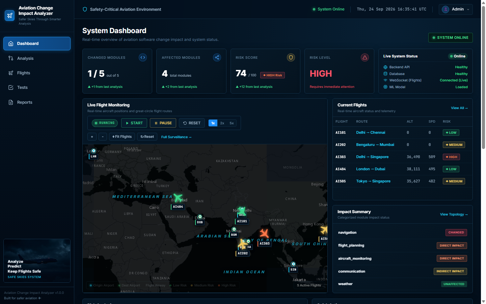
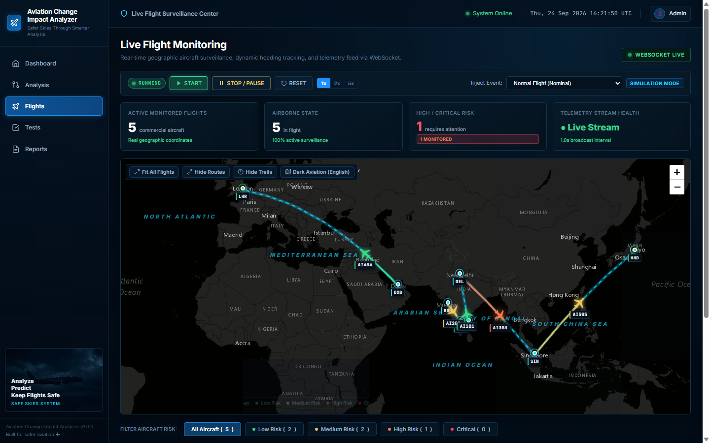
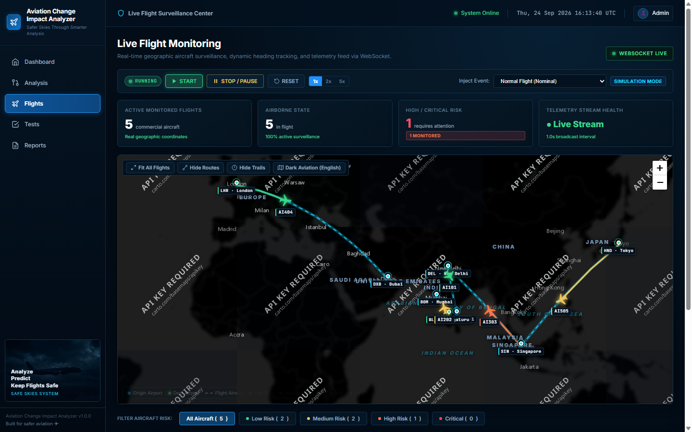

# Safety-Critical Aviation Software Change Impact Analyzer

## AI-Enabled Software Change Impact Analysis for a Synthetic Aviation Environment

---

## 1. Project Overview

The Safety-Critical Aviation Software Change Impact Analyzer is an AI-enabled software engineering system designed to analyze changes in safety-critical aviation software.

In aviation systems, a modification to one software module can affect several interconnected modules. Identifying these effects manually can be difficult and time-consuming.

This project automatically:

- Detects software changes
- Analyzes source-code structure
- Identifies module dependencies
- Determines direct and indirect impact
- Calculates software change risk
- Uses machine learning for risk prediction
- Prioritizes regression test cases
- Simulates live synthetic aircraft movement
- Provides aviation monitoring information
- Generates analysis reports

The system is developed as a synthetic aviation software environment for academic and software engineering research purposes.

---

## 2. Problem Statement

Changes in one aviation software module can unintentionally affect interconnected safety-critical components.

Manual identification of affected modules and regression tests can be difficult, especially when the software contains multiple dependencies.

Therefore, an intelligent software engineering tool is required to automatically analyze software changes, identify affected components, assess risk, and recommend regression tests before deployment.

---

## 3. Proposed Solution

The proposed system compares two versions of aviation software.

The system performs the following process:

1. Compare Version 1 and Version 2.
2. Detect changed files and functions.
3. Analyze source code using AST.
4. Construct the dependency graph.
5. Identify directly affected modules.
6. Identify indirectly affected modules.
7. Calculate risk.
8. Predict risk using machine learning.
9. Prioritize regression tests.
10. Display results through a dashboard.
11. Monitor synthetic aircraft.
12. Generate an analysis report.

---

## 4. Main Aviation Modules

The synthetic aviation environment contains:

- Navigation
- Flight Planning
- Aircraft Monitoring
- Weather
- Communication

Example dependency:

Navigation
↓
Flight Planning
↓
Aircraft Monitoring
↓
Communication

Changes to a highly connected module may therefore affect multiple components.

---

## 5. System Architecture

```text
                    ┌─────────────────────┐
                    │      Frontend       │
                    │ HTML/CSS/JavaScript │
                    └──────────┬──────────┘
                               │
                               ▼
                    ┌─────────────────────┐
                    │       FastAPI       │
                    │      Backend        │
                    └──────────┬──────────┘
                               │
             ┌─────────────────┼─────────────────┐
             │                 │                 │
             ▼                 ▼                 ▼
      Change Analysis    Flight Simulator   Report System
             │                 │
             ▼                 ▼
      Dependency Graph    Live Flight Data
             │
             ▼
       Impact Analysis
             │
             ▼
        Risk Analysis
             │
             ▼
       Machine Learning
             │
             ▼
    Regression Prioritization

## 📸 Project Screenshots

### Aviation Dashboard



### Interactive Flight Map



### Map Visualization

